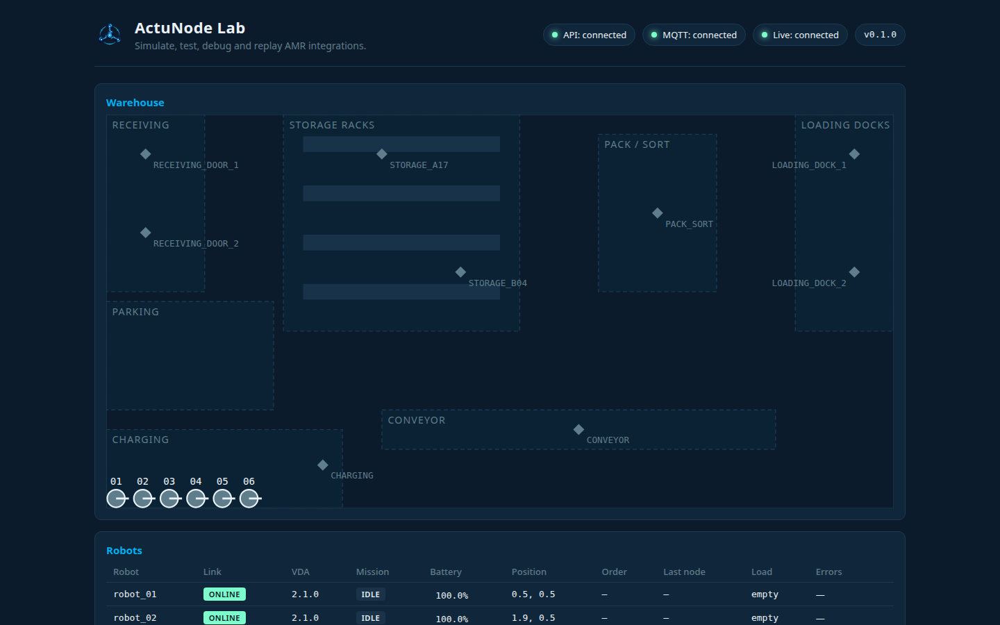
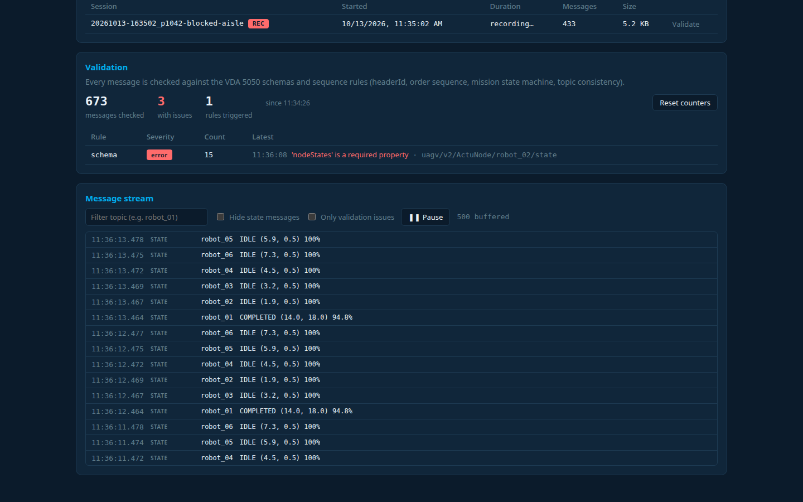
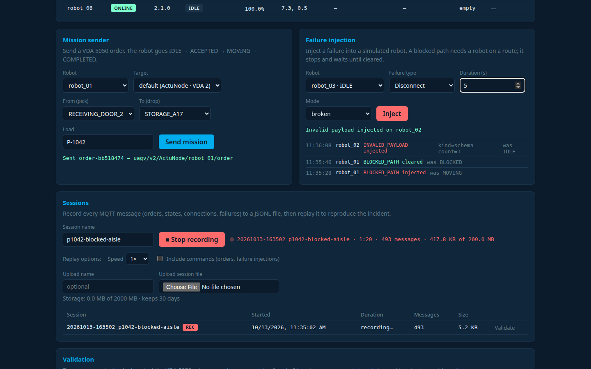
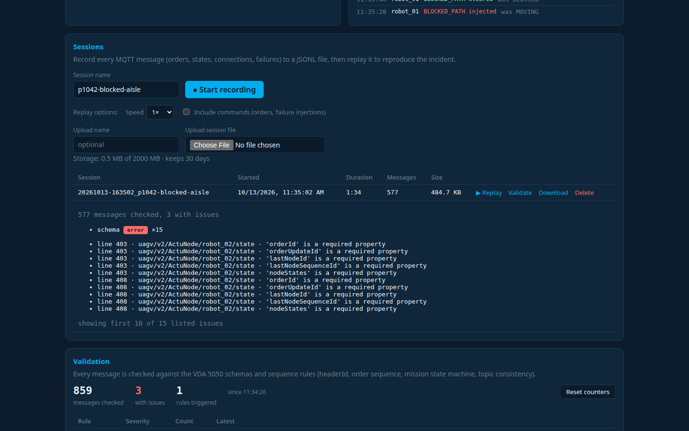
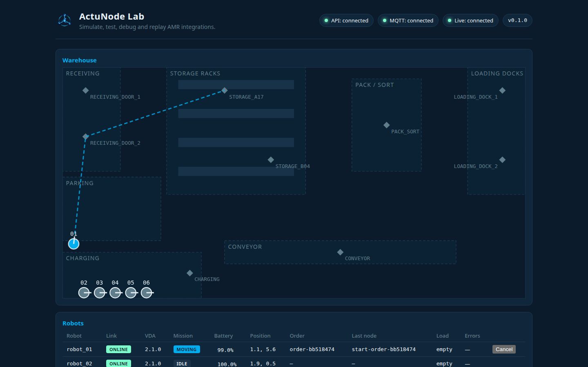
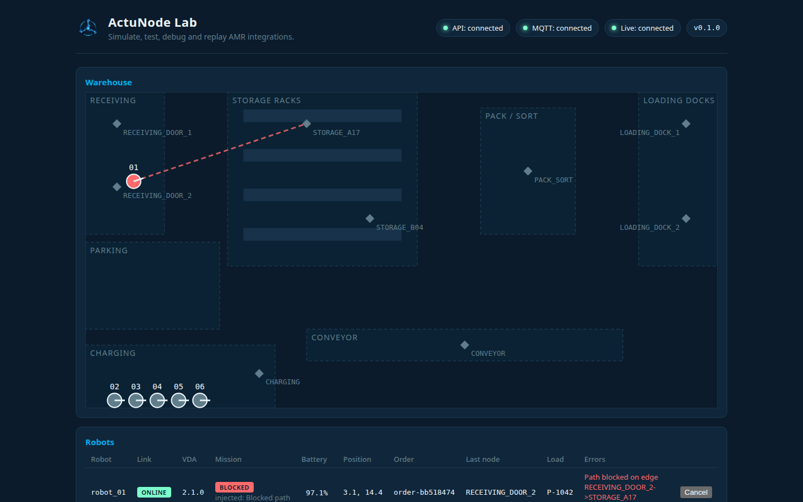

<p align="center">
  
</p>

<h1 align="center">ActuNode Lab</h1>

<p align="center">An open-source lab for testing and debugging AMR fleet integrations over VDA 5050 / MQTT.</p>

---

Integration incidents between a fleet manager, a WMS and autonomous mobile robots are hard to reproduce:
they happen on a live site, with real robots, and the evidence is gone once the robots move on. ActuNode
Lab gives you a local copy of that world. It **simulates robots**, **inspects and validates every
message** against the official VDA 5050 schemas, **injects failures** on command, and **records incidents
so you can replay them** against the system under test, with no physical fleet.



## Contents

[Features](#features) · [Quick start](#quick-start) · [Five-minute tour](#five-minute-tour) · [Sharing the lab](#sharing-the-lab-on-a-network) · [Connecting a real robot](#connecting-a-real-robot) · [Configuration](#configuration) ·
[API](#api) · [CLI](#cli-validate-a-session-file) · [Troubleshooting](#troubleshooting) · [Development](#development) · [Project status](#project-status) · [License](#license) · [Security](#security)

## Features

### Simulated AMRs

- 1 to 50 simulated robots (`ACTUNODE_SIM_ROBOTS`, default 3), one MQTT client each, with their own last
  will. They speak **VDA 5050 2.1.0 or 3.0.0** (`ACTUNODE_VDA_VERSION`), and the backend handles both at
  once, per robot, chosen by the topic (`uagv/v2/...` or `uagv/v3/...`, [D-15](docs/DECISIONS.md)).
- **Orders** per the spec: the first node must be where the robot stands, released base vs. horizon,
  pick and drop actions, version-specific error types. **Order updates** stitch at the decision point
  ([D-35](docs/DECISIONS.md)).
- **Instant actions**: `cancelOrder`, `startPause` / `stopPause`, `stateRequest`, `factsheetRequest`
  (3.0 also `clearInstantActions`). The UI and API send `cancelOrder`; the simulator handles all of them
  from any sender.
- State every second and on every VDA 5050 event; a retained **factsheet** on every connect
  ([D-34](docs/DECISIONS.md)). Battery drains 0.2 % per metre; robots **charge** in the charging area
  ([D-33](docs/DECISIONS.md)).

### Live inspector and validation

- Map, robot table and a raw message stream (filter, pause, click a row for the full JSON) over a
  WebSocket.
- Every message is checked on arrival against the **official VDA 5050 2.1.0 and 3.0.0 JSON schemas**
  (vendored, see [NOTICE](NOTICE)) plus rules that need history: `headerId` per topic, order sequence
  ids, topic/payload consistency, mission state machine and more. Issues are counted per rule in the
  Validation panel and shown inline. Rules: [docs/VDA5050_NOTES.md](docs/VDA5050_NOTES.md#what-the-validator-checks).



### Failure injection

Four failures, from the Failure injection panel or `POST /api/failures`, on simulated robots
([D-42](docs/DECISIONS.md)):

| Failure | What the robot does | Parameters (default) | Clear |
|---|---|---|---|
| `BLOCKED_PATH` | Stops on its route, `BLOCKED`, reports `pathBlocked` (2.1 WARNING, 3.0 CRITICAL) | none | yes, the mission resumes |
| `LOW_BATTERY` | Battery set to `level`; `batteryLow` below 20 % (2.1 WARNING, 3.0 URGENT) | `level` 1–99 (15) | yes, level restored |
| `DISCONNECT` | `broken`: drops the connection so the broker publishes the last will `CONNECTIONBROKEN`; `offline`: clean `OFFLINE`. Reconnects after `duration_s` | `duration_s` 1–300 (10), `mode` (broken) | no, ends by itself |
| `INVALID_PAYLOAD` | Publishes malformed messages on its state topic | `kind` `not-json` / `schema` / `wrong-serial` / `wrong-version` (schema), `count` 1–10 (1) | no |



### Near-collision detection

ActuNode **detects near-collisions and never avoids them**: traffic management is the job of the fleet
manager under test ([D-22](docs/DECISIONS.md)). When two live robots on the same map come closer than
`ACTUNODE_PROXIMITY_M` (1.0 m), a `proximity` warning goes into the stream, the Validation panel and
recordings, and a line is drawn between them on the map. Simulated robots drive straight lines, so at
25–50 robots these warnings are frequent; that is expected.

### Record, replay, validate offline

- **Record** every MQTT message the backend sees (orders, states, connections, failure injections) to
  a JSONL session file in `./sessions`. A recording stops itself at 200 MB (`ACTUNODE_MAX_SESSION_MB`).
- **Replay** republishes a session with its original timing (1× or faster), so the UI or any system
  listening on the broker sees the incident again. Robot-side traffic only by default; refused while
  robots with the same ids are live ([D-7](docs/DECISIONS.md), [D-36](docs/DECISIONS.md)).
- **Validate offline**: run a saved session through the same validator as the live feed, from the UI,
  the API or a CLI that exits non-zero for CI ([D-40](docs/DECISIONS.md)).
- **Upload** a session file someone sent you; it is checked as untrusted input, then validated and
  replayed like your own. **Retention** by age (30 days) and total size (2000 MB) ([D-41](docs/DECISIONS.md)).
- Format and rules: [docs/ARCHITECTURE.md](docs/ARCHITECTURE.md#session-file-format-v1).



### Security

- Ports are published on `127.0.0.1` only, unless you choose to share ([D-18](docs/DECISIONS.md)).
- The broker has no anonymous access. Generated passwords; **per-robot ACL**: each robot login
  (`<manufacturer>.<serial>`) may publish only its own topics and read only its own commands; only the
  backend may send orders ([D-23](docs/DECISIONS.md), [D-28](docs/DECISIONS.md)).
- Sharing on a network requires a **web login** (the backend refuses to start shared without one) and
  uses **TLS** for HTTPS and MQTT; plain ports never leave the computer ([D-25](docs/DECISIONS.md),
  [D-26](docs/DECISIONS.md)).
- The API answers only allowed `Host` names and refuses cross-site state-changing requests and
  WebSockets (**same-origin checks**, [D-24](docs/DECISIONS.md), [D-32](docs/DECISIONS.md)).
- Robot data and session files are treated as hostile input: size, depth and id limits everywhere
  ([D-31](docs/DECISIONS.md), [D-36](docs/DECISIONS.md)).

### Tested

| Suite | Count | Where |
|---|---|---|
| Backend (pytest) | 438 | CI |
| Simulator (pytest, incl. conformance against the official 2.1.0 and 3.0.0 schemas) | 391 | CI |
| Frontend (Vitest: unit, component, shared backend contract fixtures) | 96 | CI |
| End to end against the real Docker stack, incl. Chromium via Playwright | 37 | CI, three configurations: VDA 2.1, VDA 3.0, VDA 2.1 with login |
| Load test, 10 / 25 / 50 robots with missions, 18 thresholds | 18/18 passed at each size | Weekly in CI ([load.yml](.github/workflows/load.yml)) |

Plus ruff, oxlint, `tsc`, and weekly security scans (pip-audit, npm audit, Trivy). At 50 robots
([tests/load/results/latest.md](tests/load/results/latest.md)): state cadence p99 1.03 s, robot → browser
latency p99 75 ms, backend CPU 10 % of one core, backend memory 47 MiB, UI 59 fps, nothing dropped.
Method and thresholds: [tests/load/README.md](tests/load/README.md).

## Quick start

Needs Docker with Compose. Your user needs access to Docker (`sudo usermod -aG docker $USER`, then log in
again).

```bash
git clone https://github.com/Bahuncoder/ActuNode.git && cd ActuNode
docker compose up --build
```

| What | Where |
|---|---|
| Lab UI | http://localhost:8080 (or https://localhost:8443 with the local CA) |
| API docs (OpenAPI) | http://localhost:8080/api/docs |
| Backend directly | http://localhost:8000 |
| MQTT broker | `localhost:1883` (WebSocket `9001`), login required |

The header shows **API**, **MQTT** and **Live** in green when everything is up, and three robots sit in
the charging area. More robots: `ACTUNODE_SIM_ROBOTS=6 docker compose up --build`. VDA 5050 3.0 robots:
`ACTUNODE_VDA_VERSION=3`.

- Recordings are written to `./sessions` as your user. If `id -u` / `id -g` are not `1000`, start with
  `ACTUNODE_UID=$(id -u) ACTUNODE_GID=$(id -g) docker compose up --build`.
- Stop with `docker compose down`. Replay needs the simulator stopped: `docker compose stop simulator`.
- Watch raw traffic with the read-only `tools` login:

```bash
docker compose run --rm mqtt-init show tools     # prints the password
mosquitto_sub -h localhost -u tools -P '<password>' -t 'uagv/#' -v
```

## Five-minute tour

The scenario: a WMS job moves pallet **P-1042** from **Receiving door 2** to **Storage A17**, the aisle gets
blocked, and you capture the incident.

1. In **Sessions**, name the session `p1042-blocked-aisle` and click **Start recording**.
2. In **Mission sender** (prefilled: `robot_01`, `RECEIVING_DOOR_2` → `STORAGE_A17`, `P-1042`), click
   **Send mission**. The robot goes `ACCEPTED` → `MOVING`.

   

3. In **Failure injection**, choose **Blocked path** and click **Inject**. The robot stops, turns `BLOCKED`
   and reports `Path blocked on edge …`. Click **Clear**; the mission completes.

   

4. Inject **Invalid payload** (kind `schema`) on another robot and watch the **Validation** panel count it.
5. Inject **Disconnect** (mode `broken`) on a third robot: the broker publishes `CONNECTIONBROKEN`, then the
   robot comes back `ONLINE`.
6. **Stop recording**, then click **Validate** on the session row.
7. `docker compose stop simulator`, choose a speed, click **▶ Replay**: the incident happens again.

The same steps as a scripted 3-minute demo, and how the video is produced automatically:
[docs/DEMO.md](docs/DEMO.md).

The same mission and failure from the command line:

```bash
curl -X POST localhost:8080/api/missions -H 'content-type: application/json' \
  -d '{"robot_id":"robot_01","source":"RECEIVING_DOOR_2","destination":"STORAGE_A17","load_id":"P-1042"}'
curl -X POST localhost:8080/api/failures -H 'content-type: application/json' \
  -d '{"robot_id":"robot_01","failure":"BLOCKED_PATH"}'
```

With `ACTUNODE_REQUIRE_LOGIN=1`, log in first and send the cookie with every request:
`curl -c jar -X POST localhost:8080/api/login -H 'content-type: application/json' -d '{"token":"<api token>"}'`,
then add `-b jar` to the calls above.

## Sharing the lab on a network

By default nothing is reachable from the network. Sharing needs a login ([D-25](docs/DECISIONS.md)); the
backend refuses to start shared without one:

```bash
ACTUNODE_BIND_ADDRESS=0.0.0.0 ACTUNODE_REQUIRE_LOGIN=1 \
ACTUNODE_ALLOWED_HOSTS=localhost,127.0.0.1,::1,<this machine's name or IP> \
docker compose up --build
docker compose run --rm mqtt-init show api-token               # the token people enter in the browser
docker compose run --rm cert-init show ca > actunode-ca.crt   # the certificate authority to trust
```

Others open `https://<this machine>:8443` (import `actunode-ca.crt` in the browser to avoid the
certificate warning) and log in with the token. Only HTTPS (8443) and MQTT over TLS (8883) follow
`ACTUNODE_BIND_ADDRESS`; plain HTTP and MQTT ports always stay on `127.0.0.1` ([D-26](docs/DECISIONS.md)).
The certificate covers the names in `ACTUNODE_ALLOWED_HOSTS`.

## Connecting a real robot

A real robot (or your own robot driver) connects to the same broker with its own login:

```bash
docker compose run --rm mqtt-init add-robot Acme amr_7          # prints the password; user = Acme.amr_7
docker compose up -d --force-recreate mqtt-init mosquitto       # apply the new login
```

- On this computer: `localhost:1883`. From the network: MQTT over TLS on `<this machine>:8883`, trusting
  `actunode-ca.crt` (see [Sharing](#sharing-the-lab-on-a-network)).
- Topics: `uagv/v2/Acme/amr_7/...` (or `v3`). The login may publish only that robot's robot-to-master
  topics and read only its own commands (`order`, `instantActions`, ...) ([D-28](docs/DECISIONS.md)).
- Its traffic is inspected, validated and recorded like a simulated robot's. To send it a mission, name
  the target: `"manufacturer": "Acme", "vda_version": "2"` in `POST /api/missions`, or the **Target**
  select in the UI. Orders are never routed from observed traffic ([D-21](docs/DECISIONS.md)).
- Failure injection works only on ActuNode's simulated robots.

## Configuration

All variables, with defaults: [docs/ARCHITECTURE.md, Configuration](docs/ARCHITECTURE.md#configuration).
The ones you are most likely to set:

| Variable | Default | What |
|---|---|---|
| `ACTUNODE_SIM_ROBOTS` | `3` | Number of simulated robots (1–50) |
| `ACTUNODE_VDA_VERSION` | `2` | Simulated robots speak VDA 5050 2.1.0 (`2`) or 3.0.0 (`3`) |
| `ACTUNODE_BIND_ADDRESS` | `127.0.0.1` | Interface for HTTPS 8443 and MQTT/TLS 8883 (sharing) |
| `ACTUNODE_REQUIRE_LOGIN` | `0` | Web login; required when shared |
| `ACTUNODE_ALLOWED_HOSTS` | `localhost,127.0.0.1,::1` | Host names the API answers to; also the TLS certificate's names |
| `ACTUNODE_PROXIMITY_M` | `1.0` | Near-collision distance in metres |
| `ACTUNODE_MAX_SESSION_MB` | `200` | A recording stops itself at this size |
| `ACTUNODE_SESSIONS_KEEP_DAYS` | `30` | Delete sessions older than this (`0` keeps forever) |
| `ACTUNODE_SESSIONS_MAX_TOTAL_MB` | `2000` | Delete the oldest sessions above this total (`0` unlimited) |
| `ACTUNODE_UID`, `ACTUNODE_GID` | `1000` | Host user that owns `./sessions` |
| `ACTUNODE_*_HOST_PORT` | 8080, 8443, 8000, 1883, 9001, 8883 | Host ports, to run next to something else |

## API

Interactive OpenAPI docs: **http://localhost:8080/api/docs**. Full table:
[docs/ARCHITECTURE.md, HTTP API](docs/ARCHITECTURE.md#http-api).

| Area | Endpoints |
|---|---|
| Robots and live feed | `GET /api/robots`, `GET /api/messages`, `GET /api/proximity`, `WS /api/ws` |
| Missions | `POST /api/missions`, `POST /api/missions/{robot}/cancel`, `POST /api/missions/{robot}/extend` |
| Failures | `GET` / `POST /api/failures` |
| Validation | `GET /api/validation`, `POST /api/validation/reset` |
| Recording | `GET /api/recording`, `POST /api/recording/start`, `POST /api/recording/stop` |
| Sessions | `GET /api/sessions`, `GET /api/sessions/storage`, `POST /api/sessions/upload`, `POST /api/sessions/{id}/validate`, `GET /api/sessions/{id}/download`, `DELETE /api/sessions/{id}` |
| Replay | `POST /api/sessions/{id}/replay` (`speed`, `include_commands`), `GET /api/replay`, `POST /api/replay/stop` |
| Login | `GET /api/session`, `POST /api/login`, `POST /api/logout` |

MQTT topics, WebSocket events and the session file format are in
[docs/ARCHITECTURE.md](docs/ARCHITECTURE.md).

## CLI: validate a session file

Checks a session file with the same validator as the live feed, without the stack, for example in your
own CI. From `backend/` (after the development setup below):

```bash
.venv/bin/python -m app.validate_session path/to/session.jsonl
```

It prints a summary per rule and exits `0` (no errors), `1` (at least one error-severity issue) or
`2` (not a valid session file). The same check runs from the UI (**Validate**) and
`POST /api/sessions/{id}/validate`.

## Troubleshooting

| Symptom | Cause and fix |
|---|---|
| `localhost:8000` or `localhost:1883` hangs while the UI on `localhost:8080` works | A host firewall that denies outgoing connections (for example ufw with `DEFAULT_OUTPUT_POLICY="DROP"`) blocks this computer's own connections to Docker container ports. Check with `journalctl -k \| grep "UFW BLOCK"`. The UI, API docs (`localhost:8080/api/docs`) and robots are unaffected. Fix below. |
| Replay is refused | Robots with the same ids are publishing live state. `docker compose stop simulator` first. |
| Permission errors in `./sessions` | Your user id is not 1000: start with `ACTUNODE_UID=$(id -u) ACTUNODE_GID=$(id -g)`. |
| Backend exits at startup when sharing | `ACTUNODE_BIND_ADDRESS` is not loopback and `ACTUNODE_REQUIRE_LOGIN` is not `1`. |
| `mosquitto_sub` is refused | The broker needs a login: use `-u tools -P <password>` from `mqtt-init show tools`. |
| Browser warns about the certificate on 8443 | Import `actunode-ca.crt` (`docker compose run --rm cert-init show ca`). |

To allow the firewalled connections, narrowly:

```bash
sudo ufw allow out proto tcp to 172.16.0.0/12 port 1883,8000,8883,9001 comment 'ActuNode containers'
```

## Development

How to contribute: [CONTRIBUTING.md](CONTRIBUTING.md). Running the parts without Docker needs Python 3.12,
Node.js 24 (`frontend/.nvmrc`) and an MQTT broker on `localhost:1883`. Simplest: a local broker without
logins (`sudo apt install mosquitto`); backend and simulator connect anonymously when no
`ACTUNODE_MQTT_USERNAME` / `ACTUNODE_MQTT_PASSWORD_FILE` is set.

```bash
# Backend
cd backend && python3 -m venv .venv && .venv/bin/pip install -r requirements-dev.txt
.venv/bin/uvicorn app.main:app --reload --port 8000

# Frontend (second terminal; proxies /api to :8000)
cd frontend && nvm use && npm install && npm run dev      # http://localhost:5173

# Simulator (third terminal, from the repo root)
python3 -m venv simulator/.venv && simulator/.venv/bin/pip install -r simulator/requirements-dev.txt
simulator/.venv/bin/python -m simulator --robots 3        # up to 50; --vda-version 3 for 3.0
```

Tests and checks:

```bash
backend/.venv/bin/ruff check . && backend/.venv/bin/ruff format --check .
(cd backend && .venv/bin/pytest)
simulator/.venv/bin/pytest simulator
(cd frontend && npm run lint && npm test && npm run build)

# End to end: starts an isolated copy of the Docker stack (ports 18080/11883), then removes it (~2 min)
python3 -m venv tests/e2e/.venv && tests/e2e/.venv/bin/pip install -r tests/e2e/requirements.txt
tests/e2e/.venv/bin/python -m playwright install chromium   # once; add --with-deps on a fresh machine
tests/e2e/.venv/bin/pytest tests/e2e

# Load test (isolated stack, 10/25/50 robots, ~4.5 min) and the demo recorder
tests/e2e/.venv/bin/python tests/load/run_load.py
tests/e2e/.venv/bin/python tests/demo/record_demo.py
```

Offline playground with no MQTT at all (one mission through the robot state machine): `python3 main.py`.

### Repository layout

| Path | What |
|---|---|
| `backend/` | FastAPI service: missions, failures, validation, recording, replay, login |
| `frontend/` | React + TypeScript lab UI (nginx in Docker) |
| `simulator/` | Python AMR simulator, VDA 5050 2.1 and 3.0 |
| `mosquitto/`, `tls/` | Broker config, login and ACL generation, local CA |
| `contracts/` | Shared fixtures that tie backend and frontend (and simulator) message shapes |
| `tests/e2e`, `tests/load`, `tests/demo` | End-to-end tests, load test, demo recorder |
| `docs/` | Architecture, decisions, protocol notes, progress |

## Project status

ActuNode Lab is built to an 8-week plan ([docs/PLAN.md](docs/PLAN.md)). Weeks 1–7 are complete, each
closed by a quality gate (independent review, scans, a regression test for every fix, all suites green):
simulator, missions and state transitions, multi-robot map, inspector and validation, failure injection,
record and replay. Week 8 (this README, the demo video, publishing) completes the plan. Details and
measurements: [docs/PROGRESS.md](docs/PROGRESS.md); changes: [CHANGELOG.md](CHANGELOG.md).

**Out of scope** (by design or until users ask):

- `blockingType` has no effect (simulated actions are instant); no retriable actions.
- Zones, corridors and map management; the 3.0 `zoneSet` and `responses` topics are not used.
- Traffic management, path planning and collision avoidance: ActuNode detects, it does not steer (D-22).
- Safety stops (`fieldViolation`) and the `visualization` topic are not simulated.

## Documentation

| Document | What it covers |
|---|---|
| [docs/ARCHITECTURE.md](docs/ARCHITECTURE.md) | Components, topics, API, WebSocket events, session format, configuration, tests |
| [docs/DECISIONS.md](docs/DECISIONS.md) | Why things are built the way they are (D-1 to D-42) |
| [docs/VDA5050_NOTES.md](docs/VDA5050_NOTES.md) | Protocol notes and validator rules |
| [docs/research/VDA5050_3_0.md](docs/research/VDA5050_3_0.md) | VDA 5050 3.0 compared with 2.1 |
| [docs/DEMO.md](docs/DEMO.md) | 3-minute demo script and the automated recorder |
| [docs/PROGRESS.md](docs/PROGRESS.md) | Schedule, verification status, session log |
| [CHANGELOG.md](CHANGELOG.md) | Changes |

## License

Apache License 2.0, see [LICENSE](LICENSE). The vendored official VDA 5050 JSON schemas
(`backend/app/schemas/vda5050-*`) are MIT-licensed by the Verband der Automobilindustrie; see
[NOTICE](NOTICE) and the `LICENSE.txt` in each schema folder.

## Security

Please report vulnerabilities privately as described in [SECURITY.md](SECURITY.md), not in public issues.
