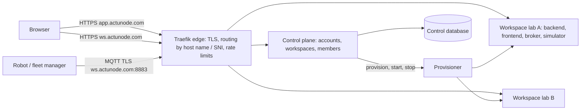

# Hosted service: ActuNode Cloud on actunode.com (design, D-61)

ActuNode as a shared online service: people sign in at **app.actunode.com** with GitHub or Google, create a
workspace, and get their own lab at **&lt;workspace&gt;.actunode.com**, with robots and fleet managers connecting to
**&lt;workspace&gt;.actunode.com:8883** (MQTT over TLS). Self-hosting stays fully supported; the hosted service runs the
same lab images.

Status: **phase 1 (invite-only beta) in design**. Billing after the beta.

## Architecture: one isolated lab per workspace

- **Workspace lab** = today's lab (published images, D-58): backend, frontend, Mosquitto, simulator, each workspace
  its own Docker Compose project and private network, its own volumes (sessions, audit trail, secrets), memory
  limits. Nothing is shared between workspaces except the edge. The backend keeps one lab per process (TRD); this
  design keeps that property instead of rewriting it.
- **Edge (Traefik)**: terminates TLS with a wildcard certificate for `*.actunode.com` (Let's Encrypt, DNS-01 through
  the Hetzner DNS API); HTTPS routed by host name; MQTT on 8883 routed by TLS SNI to the workspace's broker, plain
  inside the workspace network. Robots therefore need TLS with SNI (any current MQTT client). Rate limits per IP.
- **Control plane** (new service, `cloud/`): sign-in, workspaces, memberships and roles, invitations, the beta allow
  list, provisioning requests. FastAPI like the backend; SQLite on a volume for the beta (backed up continuously),
  PostgreSQL when more than one host is needed.
- **Provisioner**: the only component allowed to start and stop containers; renders a workspace's Compose project
  from a template and runs it. It runs separately from the web-facing control plane and talks to Docker through a
  restricted socket proxy, so a bug in the web app is not root on the host.

## Identity and access

- **Sign-in**: GitHub and Google (OAuth 2 / OpenID Connect); no passwords stored. A person is one user with one or
  more linked identities (provider + subject); email is taken from the provider.
- **Workspaces and roles**: a workspace has members with **owner**, **operator** or **viewer** (operator and viewer
  as in the lab, D-56; owner additionally manages members and deletes the workspace).
- **Into the lab (single sign-on)**: the lab gets a new login mode. The control plane signs a short-lived token
  (60 s, single use) naming the user, the role and the workspace with that workspace's own key; the browser is sent
  to `https://<ws>.actunode.com/api/sso?token=…`; the lab checks the signature, workspace, expiry and that the token
  was not used before, then opens its usual session (cookie, roles, audit trail by person). Removing a member
  revokes it in the lab at its next check, like `remove-user` today.
- **Robots and fleet managers** keep broker logins per robot and per master control (D-23, D-47), created from the
  workspace's settings page instead of `mqtt-init` commands.

## Limits and costs (beta)

- Invite-only: an allow list of GitHub logins and email addresses; one workspace per person.
- Per workspace: up to 10 simulated robots, memory caps (about 1 GB in all), session storage quota (e.g. 2 GB), the
  lab's own input limits (TRD).
- Idle labs stop after a period without users or robot traffic and start again at the next sign-in (a few
  seconds), so a single server holds many workspaces.
- Start: one Hetzner Cloud server in Germany or Finland (CPX41-class: 8 vCPU, 16 GB, about €30/month) plus a volume
  and backups; a second server and PostgreSQL when the beta outgrows it. US and Singapore regions exist for later.

## Security for the internet (beyond the lab's own, D-18–D-26, D-56)

- Only 443 and 8883 open to the world; SSH by key from fixed addresses; automatic security updates.
- Workspace networks isolated from each other and from the control plane; no Docker socket in any lab.
- Secrets per workspace generated at creation (broker logins, SSO key) and stored only in that workspace's volume
  and the control database (encrypted at rest).
- Site captures and recordings are customer data: per-workspace storage, deleted with the workspace; terms and a
  privacy policy before the beta opens; EU region by default.
- A security review of the hosted setup before inviting outside users (phase 2 gate).

## Phases

| Phase | Deliverables | Gate |
|---|---|---|
| **1. Beta foundation** | Lab SSO mode; control plane (GitHub/Google sign-in, workspaces, members, invitations, allow list); provisioner and workspace template; Traefik edge with wildcard TLS and SNI routing; the whole service runnable locally (`*.actunode.localhost`) with an end-to-end test; Terraform + cloud-init for Hetzner; deployment guide | A workspace created locally end to end: sign in, create, open the lab via SSO, a robot connects over SNI |
| **2. Run it safely** | Monitoring and alerts, backups and restore drills, upgrades of all workspaces, idle stop/start, abuse limits, security review, terms and privacy, account and workspace deletion | Review passed; restore tested; first invited users |
| **3. Paid service** | Plans and quotas, Stripe billing, team invitations at scale, usage metering (from the labs' metrics, D-57); enterprise SSO later | Pricing decided from beta usage |

## What the founder sets up (accounts and payments are the founder's)

1. Hetzner Cloud project and an API token (read/write), and Hetzner DNS for actunode.com (or another DNS provider
   with an API) plus a DNS API token.
2. A GitHub OAuth app and a Google OAuth client, with the callback URLs given in the deployment guide.
3. An SSH key for the server, and the email address for Let's Encrypt and alerts.
