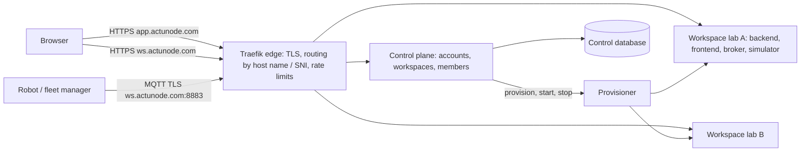

# Hosted service: ActuNode Cloud on actunode.com (design, D-61)

ActuNode as a shared online service: people sign in at **app.actunode.com** with GitHub or Google, create a
workspace, and get their own lab at **&lt;workspace&gt;.actunode.com**, with robots and fleet managers connecting to
**&lt;workspace&gt;.actunode.com:8883** (MQTT over TLS). Self-hosting stays fully supported; the hosted service runs the
same lab images.

Status (19 Oct): **phase 1 built and verified locally**: lab SSO, control plane, provisioner, edge, Hetzner infrastructure as code; `cloud/deploy/local-check.sh` passes all 16 steps (sign-in, two workspaces, SSO, a robot over TLS by SNI, isolation). Deployment: [HOSTED_DEPLOY.md](HOSTED_DEPLOY.md), waiting on the founder's accounts and the v0.4.0 release. Billing after the beta.

## Architecture: one isolated lab per workspace

- **Workspace lab** = today's lab (published images, D-58): backend, frontend, Mosquitto, simulator, each workspace
  its own Docker Compose project and private network, its own volumes (sessions, audit trail, secrets), memory
  limits. Nothing is shared between workspaces except the edge. The backend keeps one lab per process (TRD); this
  design keeps that property instead of rewriting it.
- **Edge (Traefik)**: terminates TLS with a wildcard certificate for `*.actunode.com` (Let's Encrypt, DNS-01 through
  the Hetzner DNS API); HTTPS routed by host name; MQTT on 8883 routed by TLS SNI to the workspace's broker, plain
  inside the workspace network. Robots therefore need TLS with SNI (any current MQTT client). Rate limits per IP.
- **Control plane** (new service, `cloud/`): sign-in, workspaces, memberships and roles, invitations, the beta allow
  list, provisioning requests. FastAPI like the backend; SQLite on a volume for the beta (backed up continuously),
  PostgreSQL when more than one host is needed.
- **Provisioner**: the only component allowed to start and stop containers; renders a workspace's Compose project
  from a template and runs it. It runs separately from the web-facing control plane and talks to Docker through a
  restricted socket proxy, so a bug in the web app is not root on the host.

## Identity and access

- **Sign-in**: GitHub and Google (OAuth 2 / OpenID Connect); no passwords stored. A person is one user with one or
  more linked identities (provider + subject); email is taken from the provider.
- **Workspaces and roles**: a workspace has members with **owner**, **operator** or **viewer** (operator and viewer
  as in the lab, D-56; owner additionally manages members and deletes the workspace).
- **Into the lab (single sign-on)**: "Open lab" goes to `https://<ws>.actunode.com/api/sso/start`, which leaves a
  one-time nonce cookie in the browser and redirects to the control plane with the nonce's hash. The control plane
  checks membership and redirects back to `/api/sso?token=…`, the token (60 s, single use, signed with that
  workspace's own key) naming the person, their role, the workspace and the nonce hash. The lab opens its usual
  session (8 h) only in the browser holding the nonce, so nobody can log your browser into their account (login
  CSRF). Hosted names always carry their provider (`github:octocat`, `google:alice@example.com`), so they can never
  be mistaken for a lab's local logins. Removing a member, or changing their role, revokes their lab sessions at
  once; their next sign-in gets the current role.
- **Robots and fleet managers** keep broker logins per robot and per master control (D-23, D-47), created from the
  workspace's settings page instead of `mqtt-init` commands.
- **CI token:** each lab has one shared API token that logs `actunode test` in as the operator `admin`. Owners and
  operators see it on the workspace page (an answer to a button, never in a URL or a log) and can rotate it
  (the lab's backend restarts and web sessions end); viewers cannot. If the automatic rotation after a member
  who saw it loses access fails, it is marked pending, retried every sweep and shown as an alert until it works.

## Limits and costs (beta)

- Invite-only: an allow list of GitHub logins and email addresses; one workspace per person.
- Per workspace: up to 10 simulated robots, memory caps (about 1 GB in all), session storage quota (e.g. 2 GB), the
  lab's own input limits (TRD).
- Idle labs stop after a period without use and wake at the next open (about 10 seconds), so a single server
  holds many workspaces. The lab reports how long it has been idle (`idleSeconds` in its health answer: 0 while
  anyone has the live feed open; otherwise seconds since the last signed-in request, external robot or fleet
  manager message, or command; reported only to a single-use status token signed with the workspace's key, so
  strangers learn nothing from the health answer). The control plane checks every minute (`ACTUNODE_IDLE_SWEEP_S`) and stops a lab
  idle for 30 minutes (`ACTUNODE_IDLE_STOP_S`; 0 never). **Open lab** goes through the control plane, which
  wakes a stopped lab and waits; a stopped lab's own address falls back to the control plane at the edge, which
  sends a member to the wake page. A stopped lab takes no robot connections: open it first. Two people opening
  at once wake it once (an atomic state change). Workspace states: creating, ready, failed, stopped, starting.
- Abuse limits at the edge, per client address: the control plane 20 requests/s (burst 60) and forms up to 64 KB;
  a lab 100 requests/s (burst 300); 100 open MQTT connections. In the provisioner: 50 robot and fleet manager logins
  per workspace. Labs keep their own login throttles and input limits (TRD).
- Capacity of one server (not yet measured with several busy labs): a lab's containers are capped at about 1.2 GB
  together (broker 256 MB, backend 512 MB, simulator 256 MB, frontend 128 MB), so a 16 GB server holds about
  12 labs at their caps; at rest a lab uses roughly 200 MB, so many more in practice. Stopped labs cost disk
  only. Measure before raising the invite count past ten workspaces.
- Start: one Hetzner Cloud server in Germany or Finland (CPX41-class: 8 vCPU, 16 GB, about €30/month) plus a volume
  and backups; a second server and PostgreSQL when the beta outgrows it. US and Singapore regions exist for later.

## Security for the internet (beyond the lab's own, D-18–D-26, D-56)

- Only 443 and 8883 open to the world; SSH by key from fixed addresses; automatic security updates.
- No cookie injection between workspaces: hosted labs use `__Host-` cookies (session and sign-in nonce), which only
  their own host can set, over HTTPS; the edge sends HSTS with `includeSubDomains` (and actunode.com goes on the
  browsers' preload list), so no subdomain is ever reached over plain HTTP.
- Workspace networks isolated from each other and from the control plane; no Docker socket in any lab.
- Secrets per workspace generated at creation (broker logins, SSO key) and stored only in that workspace's volume
  and the control database (encrypted at rest).
- Site captures and recordings are customer data: per-workspace storage, deleted with the workspace; terms and a
  privacy policy before the beta opens; EU region by default. Hetzner server backups do not cover the attached
  data volume: `backup.sh` archives (daily, copied off the server) are the backup (docs/HOSTED_DEPLOY.md).
- A security review of the hosted setup before inviting outside users (phase 2 gate).

## Phases

| Phase | Deliverables | Gate |
|---|---|---|
| **1. Beta foundation** | Lab SSO mode; control plane (GitHub/Google sign-in, workspaces, members, invitations, allow list); provisioner and workspace template; Traefik edge with wildcard TLS and SNI routing; the whole service runnable locally (`*.actunode.localhost`) with an end-to-end test; Terraform + cloud-init for Hetzner; deployment guide | A workspace created locally end to end: sign in, create, open the lab via SSO, a robot connects over SNI |
| **2. Run it safely** | Monitoring and alerts, backups and restore drills, upgrades of all workspaces, idle stop/start, abuse limits, security review, terms and privacy, account and workspace deletion | Review passed; restore tested; first invited users |
| **3. Paid service** | Plans and quotas, Stripe billing, team invitations at scale, usage metering (from the labs' metrics, D-57); enterprise SSO later | Pricing decided from beta usage |

## What the founder sets up (accounts and payments are the founder's)

1. Hetzner Cloud project and an API token (read/write), and Hetzner DNS for actunode.com (or another DNS provider
   with an API) plus a DNS API token.
2. A GitHub OAuth app and a Google OAuth client, with the callback URLs given in the deployment guide.
3. An SSH key for the server, and the email address for Let's Encrypt and alerts.
