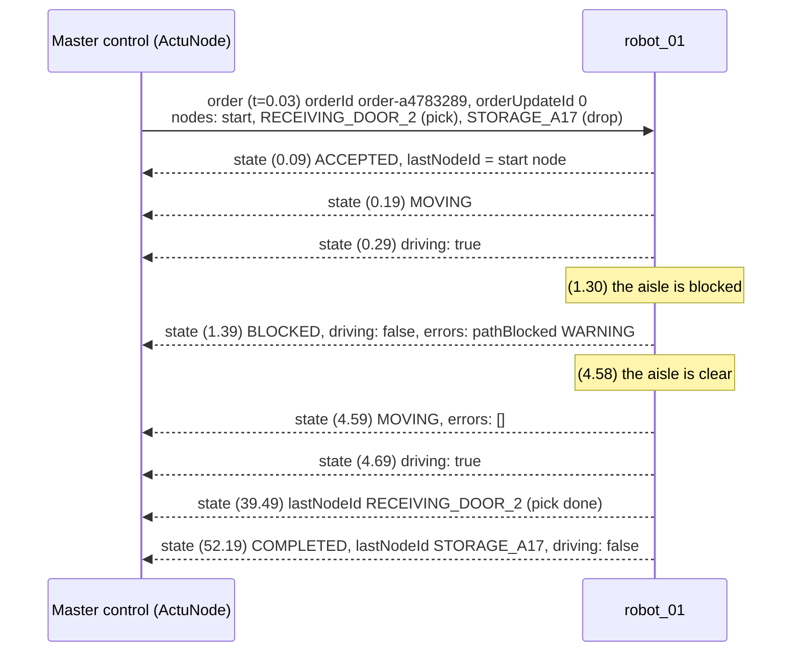
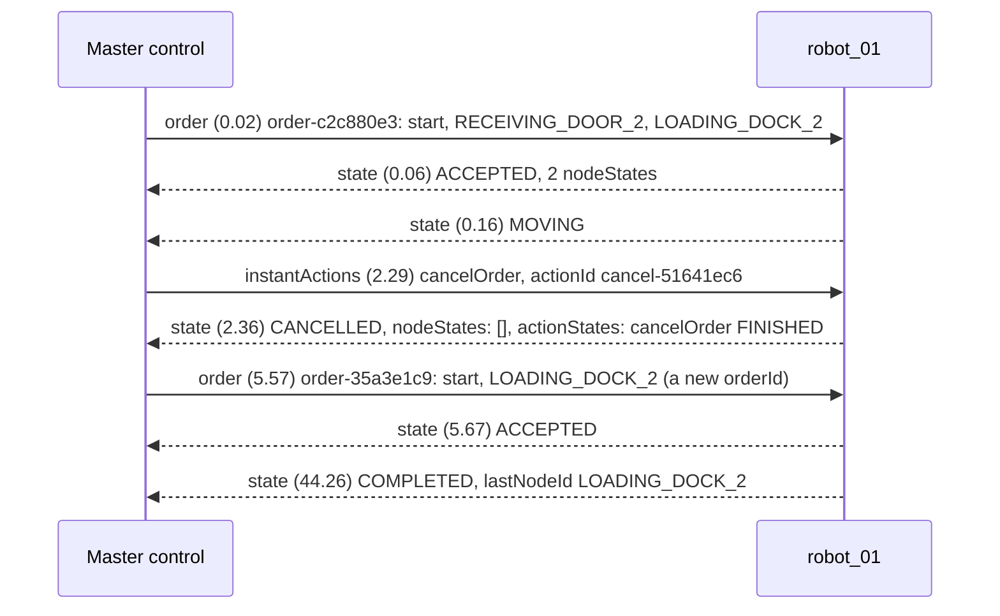
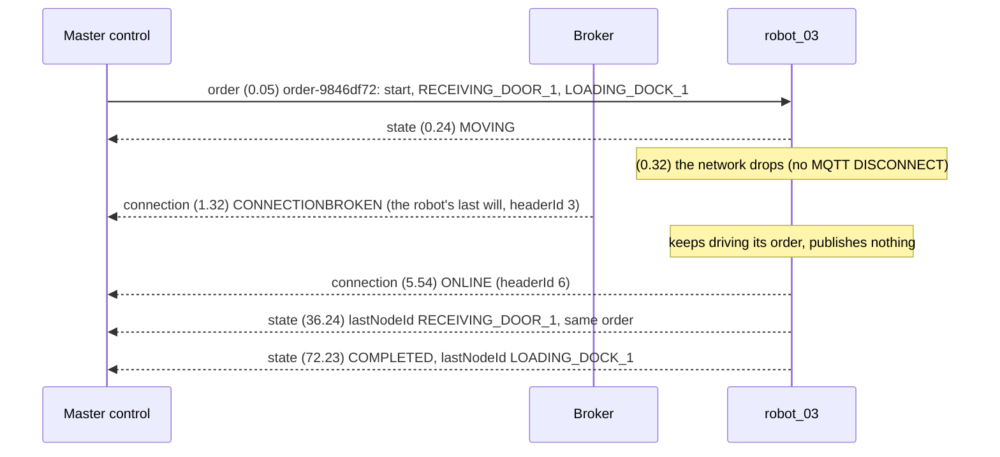

# VDA 5050 message flows, from real recordings

Three everyday situations between a master control (fleet manager) and a robot, as they look on the wire. Every
timing, id and header below comes from a session recorded in the lab on 14 Oct 2026 (VDA 5050 2.1, ActuNode's
simulated robots); you can record the same with the sample scenarios (`scenarios/`, each run is recorded) and
replay or validate it in the UI. Written for engineers integrating a fleet manager or a robot.

Topics are `uagv/v2/<manufacturer>/<serial>/<topic>`; `t` is seconds since the recording started.

## 1. An order, a blocked aisle, completion (P-1042)

Pallet P-1042 from Receiving Door 2 to Storage A17 (`scenarios/p1042_blocked_path.yaml`).

What to notice:

- **The first node is where the robot already stands.** VDA 5050 requires the first node to be trivially reachable
  ([D-35](DECISIONS.md)); ActuNode builds it from the robot's own reported position, so the robot traverses it at
  once (`lastNodeId` = start node in the first state).
- **Each change is a state event, within ~100 ms.** Order received, status change, `driving` change, a new error:
  VDA 5050 2.1 §6.10 publishes state on these events and at the latest every 30 s.
- **A blocked path is an error the robot reports, not a status the master control invents.** `pathBlocked` with
  level WARNING (2.1; CRITICAL in 3.0), and `driving: false`. What the master control *does* about it is the
  question in [examples/fleet_manager/](../examples/fleet_manager/README.md).
- **`lastNodeId` moves only when a node is reached.** 39.5 s at the pick, 52.2 s at the drop. A robot that reports a
  node it never reached is the worst conformance failure we have seen ([CONFORMANCE_ROS2_CONNECTOR.md](CONFORMANCE_ROS2_CONNECTOR.md)).

## 2. Cancel, then a new order

`scenarios/cancel_and_resume.yaml`: Receiving Door 2 to Loading Dock 2, cancelled after 2 s, then sent again.

What to notice:

- **`cancelOrder` is an instant action with its own `actionId`**, and the robot reports its progress in
  `actionStates`: FINISHED once all movement has stopped (§6.6.3). This simulated robot stops on the spot; a robot may
  also stop at the next node (§6.6.3), so a master control waits for FINISHED, not for a fixed time.
- **The cancelled order keeps its `orderId`** (§6.6.3); its node states are cleared.
- **Resuming is a new order with a new `orderId`.** An update (same `orderId`, higher `orderUpdateId`) of a cancelled
  order is refused; ActuNode's extend endpoint says so instead of sending it.

## 3. A dropped connection during a mission

`scenarios/disconnect_during_mission.yaml`: robot_03 loses its connection for 5 s on the way to Loading Dock 1.

What to notice:

- **CONNECTIONBROKEN comes from the broker, not the robot.** The robot registered it as its *last will* when it
  connected; the broker publishes it when the connection dies without a clean MQTT DISCONNECT. That is why its
  `headerId` (3) is older than the robot's latest: it was written at connect time. ActuNode's validator knows this
  and does not flag it ([D-42](DECISIONS.md)). (3.0 spells it `CONNECTION_BROKEN`.)
- **The robot does not stop.** It drives on and comes back ONLINE with the same order. A master control must not
  assume a broken connection means a stopped robot, or a lost order.
- **Retained, but not on the wire.** Robots publish connection messages *retained*, so a fleet manager that
  connects later learns every robot's state at once. Live subscribers see the retain flag only on that first
  delivery of stored messages, which is why the recording shows `retained: false` here.
- A robot that stays connected but stops answering is the harder case: no will, no ONLINE change, only silence on
  its state topic. See `scenarios/unresponsive_robot.yaml` and the catalogue entry "Silent robot".

## See it yourself

Run a sample scenario (`actunode test scenarios/cancel_and_resume.yaml`), then in the UI: Sessions → the new
recording → **Replay** (watch the map and the message stream) or **Validate**. Or replay a recording to your own
fleet manager with **Current time** ticked ([examples/fleet_manager/](../examples/fleet_manager/README.md)).
