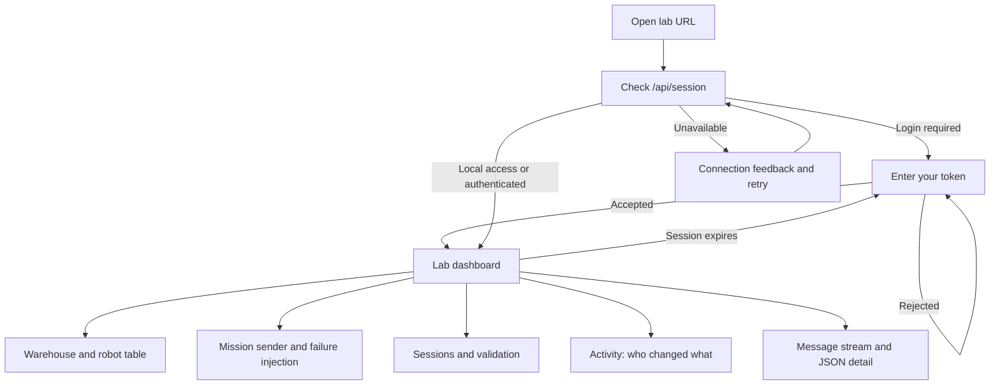
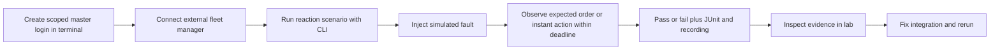

# App flow — ActuNode Lab

Working specification · updated 17 October 2026 (v0.3.0) · [PRD](PRD.md) · [Design brief](UI_UX_DESIGN_BRIEF.md)

## Entry and navigation

Current UI is one lab dashboard, with conditional login. Scenario execution and credential administration are CLI workflows; they are not existing UI screens.

With login required, each person enters their own token (or the shared admin token); the header then shows who is logged in and their role, and a viewer sees "View only" with every changing control disabled and explained. The dashboard order is header/status → replay banner when active → warehouse → robots → missions/failures → sessions/validation → activity → message stream. API, broker and live-feed status are distinct. A WebSocket reconnect obtains a new snapshot; the UI must not present old values as newly observed data.

## Journey A: first incident (PR-01–07)

1. Start Compose and open the UI; confirm API/MQTT/Live connectivity and default robots.
2. Start a named recording in Sessions. Show active state and message count.
3. Choose robot and explicit target identity, source/destination and optional pallet/load ID.
4. Send mission. Show publication result/order ID; observe the robot progress separately.
5. While moving, inject blocked path. Observe BLOCKED state and the associated protocol error.
6. Clear the blockage; observe completion. Inspect messages and validation findings as needed.
7. Stop recording, validate the session and download it as evidence.
8. Stop the simulator via the documented terminal command. Choose replay speed and optional current-time rewrite, then replay; monitor progress and stop if needed.

Recovery: API rejection leaves form values available for correction. MQTT disconnect requires reconnect before commands can publish. An incompatible failure is rejected with its reason. Replay/live identity conflict leaves the session intact and explains which live publishers must be stopped. Automatic recording stop shows size-limit or write-error reason.

## Journey B: test an external fleet manager (PR-08/09)

Use the shipped example as a first check, then replace it with the user's system. An expired expectation is a test failure; unavailable lab/broker is an infrastructure outcome. Cleanup clears only supported failures, cancels owned active missions and stops only recordings the runner owns. Time-bounded failures may outlast cleanup; report remaining duration.

## Journey C: investigate a site capture (PR-06/09)

Capture timestamp/topic/payload using the documented mosquitto format → run `actunode import` → inspect import diagnostics → upload JSONL → validate → inspect report → download/share or replay when no live identity conflicts exist.

Invalid upload: display first bad line and reason. Oversize/storage exhaustion: explain the limit without deleting other sessions. Missing end record: show incomplete status; do not label the evidence complete. Offline validation remains available without replaying commands.

## Journey D: external robot (PR-09/11)

Create scoped robot credentials → connect robot/connector → observe full identity → inspect traffic → send a mission to that identity → assess state/errors → save evidence. Use VDA fields in scenarios when an external robot lacks ActuNode-specific mission status. Failure injection remains restricted to simulated robots.

Shipped (v0.2.0): the independent ROS 2 robot (`--profile ros2`, [CONNECT_YOUR_ROBOT](../CONNECT_YOUR_ROBOT.md)) and the conformance suite (`conformance/vda5050-2/` plus `raw_checks.py`) with a known-limitations report; no in-app ROS installer.

## Journey E: run a shared lab (PR-10/15/16)

Start shared (`ACTUNODE_REQUIRE_LOGIN=1`, README "Sharing the lab") → `mqtt-init add-user <name> operator|viewer` per person, tokens handed over privately → people log in as themselves → the Activity panel (or `GET /api/audit`) shows who sent, injected, recorded, uploaded, deleted or replayed what → `remove-user` or `rotate user` locks someone out within seconds, no restart → Prometheus scrapes `/api/metrics` with a viewer token. Credential administration stays a terminal workflow; there is no user-management screen.

## Operational state rules

| State | User-visible behavior / recovery |
|---|---|
| No robots | Empty-state setup guidance; do not invent positions |
| API unavailable | Separate API status and retry feedback; preserve useful local form input |
| MQTT unavailable | Show broker status; command error must not imply robot acceptance |
| Live disconnected | Mark feed disconnected and reconnect; refresh from snapshot |
| Malformed robot state | Unknown fields/status shown safely; raw message remains inspectable |
| Recording active | Start conflict explained; stop available; active file deletion/validation restrictions enforced |
| Replay running | Persistent session/progress banner and Stop; conflicting start/deletion refused |
| Validation/upload busy | Show bounded operation state and actionable retry message |
| Session expired | Return to login; resume network-dependent activity only after authentication |
| Viewer | Changing controls disabled with "Viewers cannot change the lab"; validate, replay viewing and activity remain; a refused request shows the same text |
| User removed or token rotated | Session ends at the next request (live feed within 5 s); back to login |

## Proposed onboarding verification

Give a new participant only the public README and sample scenario. Observe journey A and one CLI run. Log time, errors, interventions and whether the recording reproduces the incident. Do not count a guided author demonstration as independent completion (PR-12). The author's fresh-clone check of [GETTING_STARTED](../GETTING_STARTED.md) (D-54) verifies the instructions, not a new user's experience.
