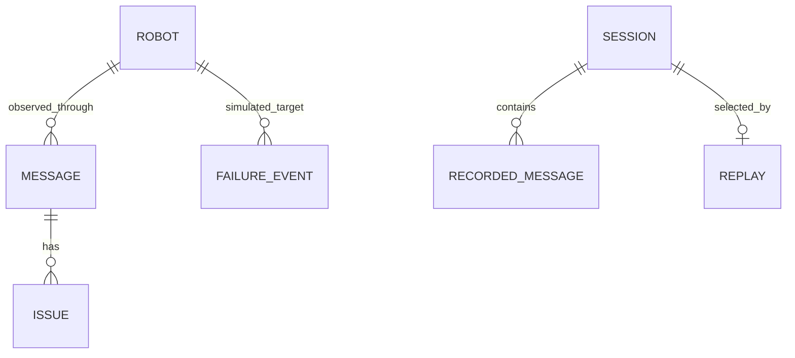

# Backend schema and data contracts — ActuNode Lab

Working specification · 15 October 2026 · [TRD](TRD.md)

## Storage model

**Current:** Python runtime objects and bounded collections plus JSONL files in `sessions/`. There are no relational tables or database migrations. The following is a logical schema of implemented entities, not proposed SQL. Source references are authoritative when optional transport fields vary.



Relationships are logical and are not enforced by foreign keys. Messages may contain invalid identities or refer to no robot. Session snapshots include a bounded projection of robot state.

## Runtime entities

| Entity | Fields / types | Identity and lifecycle |
|---|---|---|
| Robot | `key:string`, `robotId:string`, `vdaMajor?:string`, `manufacturer?:string`, `connection:string|null`, `state:object|null`, `lastSeen:string|null` | Composite topic identity; latest observed state in hub; lost on process restart |
| MqttMessage | `id:integer`, `receivedAt:UTC string`, `topic:string`, `retained:boolean`, `validJson:boolean`, `payload:unknown`, `issues:Issue[]` | Process-local incrementing ID; recent ring, not durable ID |
| Issue | `severity:error|warning`, `rule:string`, `message:string`, `path:string` | Attached to message; rule counts aggregated |
| ValidationSummary | `since:UTC string`, `checked:integer`, `withIssues:integer`, `byRule:RuleCount[]`, `epoch?:integer` | Since last reset; epoch distinguishes resets |
| RuleCount | `rule`, `description`, `severity`, `count`; optional `last:{message,topic,at}` | Aggregate by rule; one message may have multiple issues |
| FailureEntry | `injectionId`, `timestamp`, `robotId`, `failure`, `action:inject|clear`, `robotStatus`, optional `params` | Recent bounded event log; represents injection command, not durable user audit |
| RecordingStatus | `sessionId`, `name:string|null`, `startedAt`, `messageCount`, `duration`; optional `sizeBytes`, `maxBytes` | One active recorder; duration in seconds |
| ReplayStatus | `sessionId`, `state:running|finished|stopped|failed`, `speed`, `includeCommands`, optional `currentTime`, `sent`, `total`, `position`, `duration` | Process-local task; position/duration in recorded seconds |
| ProximityPair | `robots:string[]`, `distance:number` | Pair of composite robot keys; distance in metres |

See [live.ts](../../frontend/src/live.ts), [live.py](../../backend/app/live.py), [validator.py](../../backend/app/validator.py) and [recorder.py](../../backend/app/recorder.py). Payloads remain untrusted; TypeScript shapes do not validate external robot state. Robot cache and UI previews may contain reduced data with truncation markers.

## Request contracts

### Missions (PR-02/03)

`POST /api/missions` → HTTP 202 on publication:

```json
{
  "robot_id": "robot_01",
  "manufacturer": "ActuNode",
  "vda_version": "2",
  "source": "RECEIVING_DOOR_2",
  "destination": "STORAGE_A17",
  "load_id": "P-1042"
}
```

Required: `robot_id`, `destination`. Source, load and addressing are optional. `vda_version` is `"2"` or `"3"`; manufacturer/version defaults are configured, not inferred. `load_id` is at most 64 characters. Locations must exist and topic levels must pass identity validation.

Response: `{ "order_id": "…", "topic": "…", "warning": "optional identity warning" }`. HTTP 202 does not confirm robot execution.

`POST /api/missions/{robot}/cancel`: optional address body; publishes cancelOrder and returns action ID/topic. `POST /api/missions/{robot}/extend`: `to_location` required, `action:pick|drop` defaults to drop, optional address; operates on a known ActuNode-sent running order. Conflicts include unknown/foreign/cancelled orders and unconfirmed updates. See [missions.py](../../backend/app/missions.py).

### Failures (PR-04)

`POST /api/failures`: required `robot_id`; `failure` defaults to BLOCKED_PATH; `action` defaults to inject; `params` defaults to `{}`. Parameters are strict, with unknown fields refused.

| Failure | Parameters / defaults | Clear |
|---|---|---|
| BLOCKED_PATH | none | yes |
| LOW_BATTERY | integer `level` 1–99 / 15 | yes |
| DISCONNECT | integer `duration_s` 1–300 / 10; `mode:broken|offline` / broken | no |
| INVALID_PAYLOAD | `kind:not-json|schema|wrong-serial|wrong-version` / schema; integer `count` 1–10 / 1 | no |
| UNRESPONSIVE | integer `duration_s` 1–300 / 10 | no |

Clear takes no parameters. MQTT command: `{injectionId,timestamp,robotId,failure,action,params}` on `actunode/v1/sim/<serial>/inject`. See [failures.py](../../backend/app/failures.py).

### Session and authentication contracts

| Operation | Contract |
|---|---|
| GET `/api/session` | `{loginRequired:boolean, loggedIn:boolean}` |
| POST `/api/login` | `{token:string}` → HttpOnly session cookie; no user table |
| POST `/api/logout` | Ends browser session |
| GET `/api/sessions` | Array of SessionSummary |
| POST `/api/sessions/upload?name=` | Raw `application/x-ndjson` body, not multipart; returns SessionSummary on 201 |
| POST `/api/sessions/{id}/validate` | Report with `sessionId,checked,withIssues,byRule,issues,truncated`; issue samples bounded to first 100 |
| POST `/api/sessions/{id}/replay` | `speed` 0.1–20, optional `include_commands` and `current_time`; UI offers narrower speed choices |
| GET `/api/sessions/storage` | `{keepDays,maxTotalMb,usedMb,sessions}` |

SessionSummary: `sessionId:string`, `name:string|null`, `startedAt:string|null`, `endedAt?:string|null`, `messageCount:integer`, `recording:boolean`, `complete?:boolean`, `reason?:string|null`, `sizeBytes:integer`. A summary is a file projection, not a separate persisted row.

Do not normalize existing naming in place: request fields use snake_case in several endpoints while response/session fields use camelCase. Compatibility changes need a deliberate versioning decision.

## Persistent session format v1 (PR-06/07)

UTF-8 JSON Lines; one object per line. Valid minimal structural example:

```jsonl
{"type":"session","formatVersion":1,"sessionId":"20261015-120000_example","name":"example","startedAt":"2026-10-15T12:00:00Z"}
{"type":"snapshot","robots":[]}
{"type":"message","t":0.1,"receivedAt":"2026-10-15T12:00:00.100Z","topic":"uagv/v2/ActuNode/robot_01/state","retained":false,"payloadRaw":"malformed example"}
{"type":"end","endedAt":"2026-10-15T12:00:01Z","messageCount":1,"reason":"stopped"}
```

The raw example deliberately represents malformed protocol traffic; the file can carry evidence that fails protocol validation.

| Record | Required structure / semantics |
|---|---|
| session | First line; formatVersion 1, sessionId, name, startedAt |
| snapshot | Second line; bounded robot list capturing starting context |
| message | Relative `t` seconds, receive time, topic, retained flag, parsed `payload` or `payloadRaw`; optional issues/rejection metadata according to recorder |
| end | End timestamp, message count, reason: stopped, sizeLimit or writeError detail; may be absent after crash |

`t` is bounded to at most 366 days by readers; timestamps are UTC evidence, not scheduling clocks. Reject non-finite numeric values, unsafe topics for replay, excessive depth/values and oversized lines. Snapshot line budget is 8 MiB; other line budgets derive from payload limits and JSON escaping in [session_records.py](../../backend/app/session_records.py). The reader supports a torn final line; this does not permit arbitrary corrupt interior records.

Replay streams records, defaults to robot-side topics and does not react to new commands. `current_time` rewrites timestamp on JSON object payloads while preserving relative gaps; non-object payloads remain unchanged.

## WebSocket contract

`/api/ws` sends a snapshot followed by `message`, `failure`, `recording`, `replay`, `proximity`, `validation` and `sessions` events. Snapshot includes robot/message/failure/validation/recording/replay state; inspect current code for additional fields. A sessions event invalidates the list and prompts REST refetch.

A state-message event can omit duplicate `robot.state` and use `stateFromMessage:true` so the client derives it from the message. Preserve this optimization in contract fixtures. Reconnect always starts from a fresh snapshot; the live feed is not a durable event cursor API.

## Integrity, retention and future changes

Deletion of an active recorded/replayed session is refused. Offline validation of an active recording is refused. Validation/upload concurrency is bounded; busy work can return 429. Upload can return 413 size, 422 line/format, 408 stalled or 507 storage; it never evicts unrelated recordings to succeed. General API errors follow FastAPI detail responses; callers must handle string and validation-list forms.

Secrets live in mounted files/volumes, not JSONL records or a user table. Shared token login supplies access control, not per-user attribution. Cross-process IDs and transactional DB semantics must not be inferred from runtime objects.

No database migration is proposed for v0.2.0. If durable search, audit or multi-user ownership becomes necessary, first define retention, access rules and migration compatibility in a new decision; retain portable v1 artifacts or provide an explicit converter.
