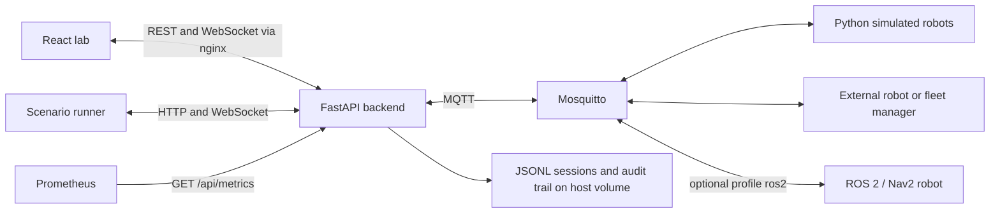

# Technical requirements document — ActuNode Lab

Working specification · updated 17 October 2026 (v0.3.0) · [PRD](PRD.md) · [Backend contracts](BACKEND_SCHEMA.md)

## Architecture and deployment

Current stack: React 19 / TypeScript with Vite, nginx serving static assets and proxying `/api`, FastAPI/Python backend, paho MQTT clients, Mosquitto broker, Python simulator and separately packaged Python CLI. Development uses Python 3.12 and Node 24 as documented in the repository. Docker Compose is the supported integrated deployment.

Use one backend process for shared in-memory state, recording ownership, replay and counters. Multiple workers/replicas are unsupported until coordination is explicitly designed. No SQL database, Redis, cloud account or Kubernetes deployment is required.

## Engineering requirements

| ID | Product link | Technical contract / verification |
|---|---|---|
| TR-01 | PR-02/09 | Robot identity is `(vdaMajor, manufacturer, serial)`; key is `v2/ActuNode/robot_01`. Command routing uses explicit request fields or configured defaults, never observed traffic. Test same serial across identities and topic-injection rejection. |
| TR-02 | PR-03/05 | Select vendored official 2.1.0/3.0.0 schemas from topic version. Add history-aware checks without rewriting evidence. Run shared contract fixtures and simulator conformance tests. |
| TR-03 | PR-05 | MQTT callbacks parse/validate, update bounded hub state under locking and hand events to asyncio. Serialize shared broadcasts once; batch frontend updates per animation frame. Slow clients reconnect to a snapshot. |
| TR-04 | PR-06/07 | Stream JSONL recording, validation and replay. Preserve monotonic relative timing separately from UTC timestamps. Stop/close on shutdown and report size/write failure reasons. |
| TR-05 | PR-04 | Failure control uses `actunode/v1/sim/<serial>/inject`, separate from VDA topics. Strict parameters and simulator targeting prevent arbitrary external fault commands. |
| TR-06 | PR-08 | CLI is a black-box API client; strict YAML rejects unknown/duplicate keys. Preserve owned-resource cleanup, recording ownership and exit code semantics. |
| TR-07 | PR-10/15 | Enforce host/origin guards, HttpOnly login cookies, per-person tokens stored only as SHA-256 (users file, re-read on change), viewer/operator roles enforced in middleware (new routes covered by default), token rate limits shared by logins and metrics bearer tokens, scoped broker ACLs and TLS sharing. Mount only required secrets; never include credentials in test artifacts. |
| TR-08 | PR-11 | Done: opt-in Compose profile `ros2`, pinned upstream commits, scoped robot login over TLS, default startup unchanged; optional patches behind a build argument (`ACTUNODE_ROS2_PATCHES=1`) so the unpatched measurement stays reproducible; a weekly workflow runs both. |
| TR-09 | PR-12 | API errors remain actionable in UI and CLI; publication success is not robot acceptance. Reconnect restores authoritative state rather than suggesting continuity of missing events. |
| TR-10 | PR-15 | Audit trail as ASGI middleware: every state-changing /api request by a known user, after it ran (user, role, client, action, target, status); logins including failed ones without a user; JSON lines rotated at 10 MB, newest 2,000 in memory for `GET /api/audit`. Route details cannot overwrite core fields. |
| TR-11 | PR-16 | `GET /api/metrics`, Prometheus text 0.0.4 without a client library: counters where events happen, gauges at scrape time, broker statistics from `$SYS/broker/#` routed before the robot pipeline (never shown, recorded or validated). |
| TR-12 | PR-17 | Release tags build amd64/arm64 images with provenance (mode=max), SBOM and a GitHub attestation; actions pinned by commit; compose opts in through `ACTUNODE_IMAGES`, `ACTUNODE_VERSION`, `ACTUNODE_PULL_POLICY`. |

## Resource and input constraints

Current implementation bounds: MQTT payload 256 KiB, JSON depth 32, 10,000 parsed values and finite numeric inputs; live robot cache 1,000 identities; recent message ring 500; failure ring 200; initial snapshot includes up to 200 recent messages. These cache limits do not claim support for simulating 1,000 robots.

WebSocket: at most 50 clients; per-client queue at most 1,000 events and 8 MiB of encoded-text accounting. Overflow closes with 1013 for reconnect. Robot states above 64 KiB and dense display payloads are reduced with markers; display preview begins above 16 KiB or 2,000 values. Full recording and rejected-input handling follow the recorder/parser contracts, not the display projection.

Sessions default to 200 MB per recording, 30-day retention and 2,000 MB total retention budget, configurable. Snapshot lines are bounded at 8 MiB. Upload must not delete existing sessions to make space. Session scanning rejects invalid structural input while handling a crash-torn final line according to the shared reader.

## Performance acceptance

Use the existing [load harness](../../tests/load/README.md), run at 10, 25 and 50 robots with missions and browser monitoring. These are acceptance thresholds, not service SLAs:

| Metric | Threshold |
|---|---|
| Periodic state cadence p99 | ≤1.2 s |
| Robot → WebSocket latency p99 | ≤250 ms |
| First snapshot p99 | ≤1 s |
| Robots/messages REST p99 | ≤200 ms |
| Backend max memory | ≤300 MiB |
| Browser median frame rate | ≥30 fps |
| Backend dropped events / browser console errors | 0 / 0 |

All remaining harness thresholds also apply. Record host, workload, version and duration. ROS 2 resource usage is measured separately; simulator benchmarks do not establish its capacity. Last full run: 17 October at fa08f92 (v0.3.0 code): every threshold passed at 10/25/50 robots with the browser; 50 robots: WebSocket latency p99 130 ms of 250, 60 frames/s, 0 console errors, 0 drops, backend memory 50 MiB of 300. The audit trail and per-message metrics counters added no measurable cost (15 October, before them: 50-robot latency p99 214 ms, a busier host). The weekly CI run (Mondays, `load.yml`) repeats it.

## Persistence, recovery and compatibility

Runtime robot state, sent orders, validation history and live IDs are process-local. JSONL files survive backend restart. The audit trail (`.audit.jsonl`, D-56) is the durable record of who changed what; runtime counters and metrics are not. An interrupted session may lack its final `end` record. Recorder shutdown must close cleanly where possible; backend restart requires clients to fetch a new snapshot.

VDA orders/state/factsheets use QoS 0; connection uses QoS 1 and retained last-will semantics. Fault injection uses QoS 1. Replay republishes selected recorded traffic; it is not a closed-loop simulator and does not reconstruct broker-wide guarantees.

Session format 1 and scenario format 1 are versioned and promised in [COMPATIBILITY.md](../COMPATIBILITY.md) (D-54); the HTTP API and metric names are kept compatible, with breaks announced a release ahead. Changes follow that page. Avoid adding storage infrastructure without a measured query, durability or collaboration need.

## Verification and release

Required checks: ruff lint/format, backend/simulator/CLI pytest, frontend lint/Vitest/TypeScript build, shared contract fixtures, Docker scenarios, e2e for VDA 2.1, VDA 3.0 and authenticated/TLS configuration, the ROS 2 workflow (unpatched and patched), the image build for both architectures, plus load and security checks applicable to the candidate. See [architecture](../ARCHITECTURE.md) for commands and workflow definitions.

PR-11 additionally needs independent-stack mission/cancel tests, raw traffic artifacts, explicit expected deviations and isolation/cleanup checks. No silent conversion of a protocol violation into a pass. Known incompatibilities must name the component/version, observed behavior and reproduction steps.
